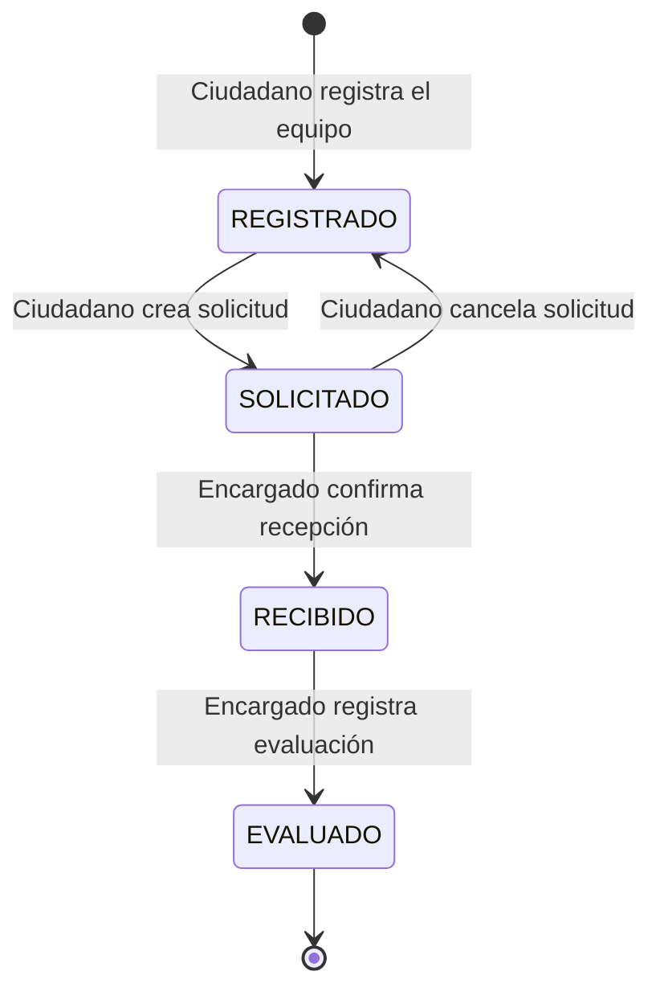

# PRD — Sistema Web para la Gestión y Trazabilidad de RAEE

**Huancayo, Junín — Perú**

| Campo | Valor |
|---|---|
| Producto | Sistema Web para la Gestión y Trazabilidad de Residuos de Aparatos Eléctricos y Electrónicos (RAEE) |
| Versión del documento | 1.0 |
| Fecha | 22 de noviembre de 2026 |
| Ámbito geográfico | Provincia de Huancayo, departamento de Junín, Perú |
| Estado | Documento base de producto |
| Audiencia | Producto, operaciones, municipio, centros de acopio y equipo de desarrollo |

---

## 1. Resumen ejecutivo

El sistema es una plataforma web que conecta a la ciudadanía con los puntos de acopio de RAEE de Huancayo y permite seguir, paso a paso, el destino de cada aparato eléctrico o electrónico entregado.

El producto resuelve tres necesidades concretas:

1. **El ciudadano** necesita saber dónde entregar un equipo en desuso y qué ocurrió después con él.
2. **El centro de acopio** necesita ordenar la recepción de equipos, registrar su estado físico y definir su destino ambiental.
3. **La municipalidad** necesita evidencia verificable de cuántos equipos se gestionaron, cuánto pesaron y cuánto se valorizó frente a lo que terminó en disposición final.

Para lograrlo, cada dispositivo recibe un **código de seguimiento único** y avanza por un flujo de estados controlado: `REGISTRADO → SOLICITADO → RECIBIDO → EVALUADO`. Cada cambio queda registrado en un **historial de trazabilidad inmutable**, consultable por el ciudadano y por cualquier persona que tenga el código.

---

## 2. Contexto y problema

### 2.1 Situación actual

En Huancayo, la entrega de RAEE suele ocurrir de forma informal o dispersa. Los ciudadanos no siempre conocen los puntos autorizados, los centros de acopio no cuentan con un registro ordenado de lo que reciben y la municipalidad no dispone de información consolidada para reportar la gestión ambiental.

### 2.2 Problemas identificados

| Problema | Consecuencia |
|---|---|
| Desconocimiento de puntos de acopio y horarios | Equipos almacenados en hogares o eliminados con la basura común |
| Registro manual o inexistente de equipos recibidos | Pérdida de evidencia sobre cantidad, peso y destino |
| Falta de seguimiento posterior a la entrega | Desconfianza ciudadana y baja participación |
| Información dispersa entre áreas | Dificultad para reportar indicadores ambientales |
| Ausencia de control por roles | Riesgo de manipulación de datos y accesos indebidos |

### 2.3 Oportunidad

Una plataforma única, con trazabilidad pública y roles claros, permite profesionalizar la gestión de RAEE sin aumentar la carga operativa de los centros de acopio.

---

## 3. Visión y propuesta de valor

> **Visión:** que cualquier ciudadano de Huancayo pueda entregar un RAEE con la confianza de saber exactamente qué ocurrió con él, y que la municipalidad pueda demostrar el impacto ambiental de esa gestión con datos verificables.

**Propuesta de valor por actor:**

- **Ciudadano:** registro simple, código de seguimiento y transparencia total del destino del equipo.
- **Centro de acopio:** bandeja ordenada de solicitudes, recepción controlada y evaluación técnica estandarizada.
- **Municipalidad:** indicadores consolidados de dispositivos, peso valorizado y disposición final.
- **Sociedad:** evidencia pública de una gestión ambiental responsable.

---

## 4. Objetivos

### 4.1 Objetivo general

Implementar un sistema web que gestione el ciclo de vida de los RAEE en Huancayo, desde el registro del equipo por parte del ciudadano hasta su evaluación y destino ambiental, garantizando trazabilidad, control por roles y generación de indicadores.

### 4.2 Objetivos específicos

| ID | Objetivo | Resultado esperado |
|---|---|---|
| OE-01 | Facilitar el registro de equipos RAEE | El ciudadano registra un equipo en menos de 3 minutos y obtiene un código de seguimiento |
| OE-02 | Ordenar la entrega y recolección | Cada equipo tiene una solicitud con centro, modalidad y fecha programada |
| OE-03 | Controlar la recepción física | El encargado confirma la recepción solo de equipos dirigidos a su centro |
| OE-04 | Estandarizar la evaluación técnica | Toda evaluación registra condición, operatividad, peso y destino ambiental |
| OE-05 | Garantizar trazabilidad pública | Cualquier persona con el código consulta la ficha y el historial completo |
| OE-06 | Generar información para la gestión municipal | El administrador obtiene indicadores globales por estado y peso |
| OE-07 | Proteger la información personal | La consulta pública nunca expone datos del ciudadano |

### 4.3 Indicadores de éxito (KPI)

| Indicador | Meta inicial |
|---|---|
| Equipos registrados con código de seguimiento | 100 % de los equipos registrados |
| Equipos con historial completo hasta evaluación | ≥ 80 % de los equipos recepcionados |
| Tiempo medio entre recepción y evaluación | ≤ 5 días hábiles |
| Consultas públicas de rastreo exitosas | ≥ 90 % de las consultas con código válido |
| Peso valorizado sobre peso total evaluado | Medición mensual, sin meta fija el primer año |
| Satisfacción del ciudadano con el proceso | ≥ 4 de 5 |

---

## 5. Alcance

### 5.1 En alcance

- Registro público de ciudadanos y autenticación por correo y contraseña.
- Consulta pública de trazabilidad mediante código de seguimiento.
- Registro y listado de dispositivos RAEE del ciudadano.
- Creación y cancelación de solicitudes de entrega presencial o recolección.
- Bandeja de solicitudes por centro de acopio y confirmación de recepción.
- Evaluación técnica con condición física, operatividad, peso y destino ambiental.
- Administración de usuarios, encargados y centros de acopio.
- Catálogos de distritos de Junín, categorías de RAEE, tipos de destino y centros activos.
- Reporte resumen global para el administrador.
- Historial de trazabilidad inmutable por dispositivo.

### 5.2 Fuera de alcance (versión actual)

- Pagos, incentivos económicos o compensaciones por entrega.
- Notificaciones automáticas por correo, SMS o aplicación móvil.
- Optimización de rutas de recolección o logística de transporte.
- Aplicación móvil nativa.
- Integración con sistemas municipales externos, aduanas o empresas certificadoras.
- Carga de fotografías, documentos o certificados de disposición final.
- Edición o eliminación de dispositivos y evaluaciones ya registradas.
- Gestión de inventario, almacenamiento temporal o venta de materiales recuperados.
- Multi-centro para un mismo encargado.
- Firma digital o certificados ambientales descargables.

---

## 6. Perfiles de usuario

El sistema define **cuatro perfiles**. Los tres primeros se corresponden con roles autenticados; el visitante público no requiere cuenta.

### 6.1 Ciudadano público sin cuenta (consulta de rastreo)

**Descripción:** cualquier persona que accede a la plataforma sin registrarse, normalmente porque tiene el código de seguimiento de un equipo.

**Objetivo:** conocer el estado y el destino de un RAEE de forma inmediata y transparente.

**Puede hacer:**

- Consultar la ficha pública de un equipo por su código de seguimiento.
- Ver la línea de tiempo completa de estados, comentarios y fechas.
- Consultar catálogos públicos: distritos, categorías de RAEE, tipos de destino y centros de acopio activos.

**No puede hacer:**

- Ver nombres, correos, teléfonos, direcciones ni ningún dato personal del ciudadano.
- Registrar equipos, crear solicitudes ni evaluar dispositivos.
- Acceder a información de otros usuarios o a reportes internos.

**Regla de privacidad:** la ficha pública muestra únicamente información del equipo y de su proceso, nunca del generador.

---

### 6.2 Ciudadano registrado

**Descripción:** persona natural que crea una cuenta en la plataforma para gestionar la entrega de sus equipos.

**Objetivo:** registrar sus RAEE, coordinar la entrega o recolección y seguir su trazabilidad.

**Puede hacer:**

- Registrarse con nombres, apellidos, correo, contraseña, teléfono, distrito y dirección.
- Iniciar sesión y consultar su perfil.
- Registrar uno o varios dispositivos RAEE.
- Ver el listado de sus dispositivos con estado actual, destino final y peso.
- Crear una solicitud de entrega presencial o de recolección.
- Elegir el centro de acopio y la fecha programada.
- Cancelar una solicitud mientras siga pendiente.
- Consultar el código de seguimiento de cada equipo.

**No puede hacer:**

- Ver dispositivos de otros ciudadanos.
- Crear solicitudes para equipos ajenos.
- Confirmar recepciones o registrar evaluaciones.
- Modificar el estado de un equipo por fuera del flujo establecido.

---

### 6.3 Encargado de punto de acopio

**Descripción:** usuario operativo asignado a un único centro de acopio. Es creado por el administrador.

**Objetivo:** recibir los equipos y registrar su evaluación técnica y destino ambiental.

**Puede hacer:**

- Iniciar sesión y consultar su perfil.
- Ver la bandeja de solicitudes dirigidas a su centro.
- Filtrar solicitudes por estado.
- Ver los datos de contacto del ciudadano para coordinar la entrega o recolección.
- Confirmar la recepción física de un equipo.
- Registrar la evaluación técnica del equipo recibido.
- Definir el destino ambiental: reutilización, reparación, recuperación de componentes, reciclaje o disposición final.

**No puede hacer:**

- Ver solicitudes de otros centros de acopio.
- Recepcionar solicitudes ajenas o ya procesadas.
- Evaluar equipos que no hayan sido recibidos en su centro.
- Administrar usuarios, centros o reportes globales.
- Modificar una evaluación ya registrada.

**Regla operativa:** un encargado sin centro de acopio asignado no puede operar; el sistema debe impedirle recepcionar o evaluar.

---

### 6.4 Administrador

**Descripción:** usuario con visión global del sistema, típicamente personal municipal o responsable del programa.

**Objetivo:** configurar la operación, administrar cuentas y centros, y monitorear los resultados.

**Puede hacer:**

- Iniciar sesión y consultar su perfil.
- Listar todos los usuarios registrados con su rol, distrito, centro asignado y estado.
- Crear cuentas de encargado y asignarlas a un centro de acopio.
- Activar o desactivar cuentas de usuario.
- Crear centros de acopio con nombre, dirección, teléfono, distrito y coordenadas.
- Activar o desactivar centros de acopio.
- Consultar el reporte resumen global del sistema.

**No puede hacer:**

- Registrarse a sí mismo como administrador desde el formulario público.
- Recepcionar equipos o registrar evaluaciones.
- Modificar el historial de trazabilidad.
- Eliminar usuarios, centros, dispositivos o evaluaciones.

**Regla de gobierno:** las cuentas de administrador se aprovisionan fuera del flujo público de registro.

---

### 6.5 Matriz de permisos

| Acción | Público sin cuenta | Ciudadano | Encargado | Administrador |
|---|:---:|:---:|:---:|:---:|
| Consultar rastreo por código | ✅ | ✅ | ✅ | ✅ |
| Ver catálogos públicos | ✅ | ✅ | ✅ | ✅ |
| Registrarse como ciudadano | ✅ | — | — | — |
| Iniciar sesión | — | ✅ | ✅ | ✅ |
| Registrar dispositivo RAEE | — | ✅ | — | — |
| Ver dispositivos propios | — | ✅ | — | — |
| Crear solicitud | — | ✅ | — | — |
| Cancelar solicitud propia | — | ✅ | — | — |
| Ver solicitudes de su centro | — | — | ✅ | — |
| Confirmar recepción | — | — | ✅ | — |
| Registrar evaluación | — | — | ✅ | — |
| Listar usuarios | — | — | — | ✅ |
| Crear encargado | — | — | — | ✅ |
| Activar/desactivar usuario | — | — | — | ✅ |
| Crear/activar/desactivar centro | — | — | — | ✅ |
| Ver reporte resumen | — | — | — | ✅ |

---

## 7. Flujo de estados de un dispositivo RAEE

### 7.1 Flujo principal

**Cadena principal:** `REGISTRADO → SOLICITADO → RECIBIDO → EVALUADO`

**Salida alternativa:** desde `SOLICITADO`, el ciudadano puede cancelar la solicitud. La solicitud pasa a `CANCELADA` y el dispositivo **vuelve a `REGISTRADO`**, quedando disponible para una nueva solicitud.

> **Importante:** `CANCELADO` es un estado de la **solicitud**, no un estado definitivo del dispositivo. El dispositivo no se destruye ni se da de baja: regresa a `REGISTRADO`.

### 7.2 Estados del dispositivo

| Estado | Significado | Responsable de la transición |
|---|---|---|
| `REGISTRADO` | El equipo existe en el sistema y aún no tiene una solicitud activa | Ciudadano |
| `SOLICITADO` | Existe una solicitud pendiente de entrega o recolección | Ciudadano |
| `RECIBIDO` | El equipo fue entregado físicamente en el centro de acopio | Encargado |
| `EVALUADO` | El equipo fue inspeccionado y tiene destino ambiental asignado | Encargado |

### 7.3 Estados de la solicitud

| Estado | Significado |
|---|---|
| `PENDIENTE` | Solicitud creada, a la espera de recepción |
| `COMPLETADA` | El equipo fue recepcionado en el centro |
| `CANCELADA` | El ciudadano canceló la solicitud antes de la recepción |

### 7.4 Transiciones, condiciones y efectos

| # | Transición | Quién | Condiciones | Efecto |
|---|---|---|---|---|
| T-01 | `— → REGISTRADO` | Ciudadano | Equipo con categoría, marca y modelo válidos | Se genera el código `RAEE-AAAA-####` y el primer evento del historial |
| T-02 | `REGISTRADO → SOLICITADO` | Ciudadano | El equipo pertenece al ciudadano, está en `REGISTRADO`, el centro existe y está activo, y no hay otra solicitud pendiente | Se crea la solicitud `PENDIENTE` y el evento de historial |
| T-03 | `SOLICITADO → RECIBIDO` | Encargado | La solicitud está `PENDIENTE` y pertenece al centro del encargado | La solicitud pasa a `COMPLETADA` y se registra el evento |
| T-04 | `RECIBIDO → EVALUADO` | Encargado | El equipo fue recepcionado en el centro del evaluador, está en `RECIBIDO` y no tiene evaluación previa | Se crea la evaluación, se asigna destino y se registra el evento |
| T-05 | `SOLICITADO → REGISTRADO` | Ciudadano | La solicitud está `PENDIENTE` y pertenece al ciudadano | La solicitud pasa a `CANCELADA` y se registra el evento |

### 7.5 Reglas del flujo

- **RN-F01 — Un solo camino hacia adelante.** No se puede saltar de `REGISTRADO` a `RECIBIDO` ni de `SOLICITADO` a `EVALUADO`.
- **RN-F02 — Una solicitud pendiente por equipo.** Un dispositivo no puede tener dos solicitudes pendientes simultáneas.
- **RN-F03 — Una evaluación por equipo.** La evaluación técnica es única e irreversible.
- **RN-F04 — Cancelación solo en pendiente.** Solo se cancela una solicitud que aún no fue recepcionada.
- **RN-F05 — Reintento permitido.** Tras una cancelación, el equipo vuelve a `REGISTRADO` y puede generar una nueva solicitud.
- **RN-F06 — Historial inmutable.** Ningún evento del historial puede modificarse ni eliminarse; solo se agregan eventos.
- **RN-F07 — Responsable identificado.** Todo cambio de estado registra al usuario que lo ejecutó, la fecha, el estado anterior, el estado nuevo y un comentario.

### 7.6 Historial de trazabilidad

Cada equipo cuenta con una línea de tiempo cronológica. Un evento contiene:

| Campo | Descripción |
|---|---|
| Estado anterior | Estado previo del equipo; vacío en el registro inicial |
| Estado nuevo | Estado alcanzado |
| Comentario | Explicación legible del cambio |
| Fecha y hora | Momento exacto del cambio |
| Responsable | Usuario que ejecutó la acción (no visible en la consulta pública) |

**Ejemplo de línea de tiempo:**

1. `— → REGISTRADO` — Dispositivo registrado por el ciudadano en la plataforma.
2. `REGISTRADO → SOLICITADO` — Solicitud presencial programada para el Centro de Acopio El Tambo.
3. `SOLICITADO → RECIBIDO` — Equipo recepcionado físicamente en el centro de acopio.
4. `RECIBIDO → EVALUADO` — Evaluación completada: destino Recuperación de componentes.

---

## 8. Módulos y reglas de negocio

### 8.1 Módulo de acceso y cuentas

**Propósito:** permitir el ingreso seguro y diferenciado de ciudadanos, encargados y administradores.

**Funcionalidades:**

- Registro público de ciudadanos.
- Inicio de sesión con correo y contraseña.
- Consulta del perfil autenticado.
- Activación y desactivación de cuentas por parte del administrador.

**Reglas de negocio:**

- **RN-01 — Correo único.** No puede existir más de una cuenta con el mismo correo, sin distinguir mayúsculas y minúsculas.
- **RN-02 — Contraseña mínima.** La contraseña debe tener al menos 8 caracteres y nunca se muestra ni se devuelve en las respuestas del sistema.
- **RN-03 — Registro público solo para ciudadanos.** El formulario público crea exclusivamente cuentas con rol Ciudadano.
- **RN-04 — Cuenta activa obligatoria.** Una cuenta desactivada no puede iniciar sesión, aunque sus credenciales sean correctas; al vencer su sesión vigente tampoco podrá renovarla.
- **RN-05 — Sesión con vigencia limitada.** La sesión expira por seguridad; por defecto, a los 60 minutos.
- **RN-06 — Permisos por rol.** Cada perfil accede únicamente a las funciones descritas en la matriz de permisos.
- **RN-07 — Distrito válido.** Todo usuario debe estar asociado a un distrito de Junín.
- **RN-08 — Asignación coherente.** Un encargado debe tener un centro de acopio; un ciudadano o administrador no debe tener centro asignado.
- **RN-09 — Sin autoascenso.** Ningún usuario puede otorgarse a sí mismo el rol de administrador o encargado.

---

### 8.2 Módulo de catálogos

**Propósito:** proporcionar información maestra consistente para todo el sistema.

**Catálogos disponibles:**

| Catálogo | Uso |
|---|---|
| Distritos de Junín | Registro de usuarios y centros de acopio |
| Categorías de RAEE | Clasificación del dispositivo |
| Tipos de destino | Evaluación y destino ambiental |
| Centros de acopio | Selección del punto de entrega |

**Categorías de RAEE consideradas:**

1. Informática y Telecomunicaciones.
2. Pequeños Electrodomésticos.
3. Grandes Electrodomésticos.
4. Aparatos Electrónicos de Consumo.
5. Herramientas Eléctricas y Electrónicas.

**Tipos de destino ambiental:**

| Destino | ¿Valorización? | Descripción |
|---|:---:|---|
| Reutilización | Sí | El equipo funciona y se destina a uso directo o donación |
| Reparación | Sí | El equipo presenta fallas menores y pasa a reacondicionamiento |
| Recuperación de componentes | Sí | Se extraen piezas útiles como RAM, discos y placas |
| Reciclaje | Sí | Se recuperan metales, cobre, oro y plásticos |
| Disposición final | No | Confinamiento controlado de componentes peligrosos no aprovechables |

**Reglas de negocio:**

- **RN-10 — Catálogos públicos de consulta.** Distritos, categorías, destinos y centros activos pueden consultarse sin iniciar sesión.
- **RN-11 — Catálogos maestros controlados.** Solo el administrador puede crear o modificar centros; las categorías y destinos son datos maestros del sistema.
- **RN-12 — Centro activo para nuevas solicitudes.** Un centro desactivado no puede seleccionarse para nuevas entregas o recolecciones.
- **RN-13 — Desactivación sin pérdida de historial.** Desactivar un centro no elimina ni altera las solicitudes, recepciones o evaluaciones ya registradas.

---

### 8.3 Módulo de centros de acopio

**Propósito:** mantener actualizada la red de puntos físicos de recepción.

**Datos de un centro:**

- Nombre del centro.
- Dirección.
- Teléfono de contacto.
- Distrito.
- Coordenadas geográficas (latitud y longitud), opcionales.

**Reglas de negocio:**

- **RN-14 — Registro exclusivo del administrador.** Solo el administrador crea centros de acopio.
- **RN-15 — Centro activo por defecto.** Todo centro nuevo nace activo y disponible para solicitudes.
- **RN-16 — Baja lógica.** Un centro se desactiva, no se elimina; su historial se conserva.
- **RN-17 — Centro visible solo si está activo.** La consulta pública de centros muestra por defecto únicamente los activos.

---

### 8.4 Módulo de registro de dispositivos RAEE

**Propósito:** incorporar el equipo al sistema y generar su identidad de seguimiento.

**Datos obligatorios:**

- Categoría de RAEE.
- Marca.
- Modelo.

**Datos opcionales:**

- Descripción libre del estado o características del equipo.

**Reglas de negocio:**

- **RN-18 — Registro solo por ciudadano autenticado.** El equipo queda asociado al ciudadano que lo registra.
- **RN-19 — Código único de seguimiento.** Todo equipo recibe un código con formato `RAEE-AAAA-####`, generado automáticamente y no reutilizable.
- **RN-20 — Estado inicial.** Todo equipo nace en estado `REGISTRADO`.
- **RN-21 — Primer evento de historial.** El registro genera automáticamente el evento inicial de trazabilidad.
- **RN-22 — Sin edición ni borrado.** El dispositivo no puede modificarse ni eliminarse después de registrado; los cambios se reflejan en el flujo de estados.
- **RN-23 — Visibilidad restringida.** Cada ciudadano ve únicamente sus propios dispositivos.

---

### 8.5 Módulo de solicitudes de entrega y recolección

**Propósito:** coordinar la entrega del equipo en un centro de acopio.

**Modalidades:**

| Modalidad | Descripción |
|---|---|
| `PRESENCIAL` | El ciudadano lleva el equipo al centro de acopio |
| `RECOLECCION` | Se coordina la recolección del equipo |

**Datos de la solicitud:**

- Equipo RAEE.
- Centro de acopio.
- Modalidad.
- Fecha y hora programada.

**Reglas de negocio:**

- **RN-24 — Solo equipos propios y disponibles.** El ciudadano solo puede solicitar equipos que le pertenecen y que estén en estado `REGISTRADO`.
- **RN-25 — Una solicitud pendiente por equipo.** No se permite una segunda solicitud mientras exista una pendiente.
- **RN-26 — Centro existente y activo.** La solicitud debe apuntar a un centro de acopio válido y habilitado.
- **RN-27 — Modalidad válida.** Solo se aceptan las modalidades `PRESENCIAL` y `RECOLECCION`.
- **RN-28 — Fecha programada obligatoria.** Toda solicitud debe indicar fecha y hora de entrega o recolección.
- **RN-29 — Cambio automático de estado.** Crear la solicitud mueve el equipo de `REGISTRADO` a `SOLICITADO`.
- **RN-30 — Cancelación con retorno.** El ciudadano puede cancelar su solicitud mientras esté `PENDIENTE`; el equipo vuelve a `REGISTRADO`.
- **RN-31 — Cancelación solo del titular.** Nadie más que el ciudadano propietario puede cancelar su solicitud.
- **RN-32 — Trazabilidad de la cancelación.** La cancelación genera un evento en el historial con el motivo y la fecha.

---

### 8.6 Módulo de recepción en centro de acopio

**Propósito:** confirmar que el equipo llegó físicamente al centro y cerrar la solicitud.

**Funcionalidades:**

- Bandeja de solicitudes del centro asignado.
- Filtro por estado de solicitud.
- Vista de datos del equipo y del ciudadano para coordinar la entrega.
- Confirmación de recepción.

**Reglas de negocio:**

- **RN-33 — Aislamiento por centro.** El encargado solo ve las solicitudes dirigidas a su centro de acopio.
- **RN-34 — Encargado activo y asignado.** Solo un encargado activo con centro asignado puede recepcionar.
- **RN-35 — Recepción solo de solicitudes pendientes.** Una solicitud ya completada o cancelada no puede recepcionarse.
- **RN-36 — Recepción solo en el centro correcto.** El encargado no puede recepcionar solicitudes de otro centro.
- **RN-37 — Cierre de la solicitud.** Al confirmar la recepción, la solicitud pasa a `COMPLETADA`.
- **RN-38 — Cambio automático de estado.** El equipo pasa de `SOLICITADO` a `RECIBIDO`.
- **RN-39 — Evidencia de recepción.** Se registra el evento con fecha, encargado y comentario.
- **RN-40 — Datos de contacto con propósito operativo.** El encargado ve teléfono y dirección del ciudadano únicamente para coordinar la entrega o recolección.

---

### 8.7 Módulo de evaluación técnica y destino ambiental

**Propósito:** determinar el estado del equipo y asignar su destino final dentro de la jerarquía de gestión de RAEE.

**Datos de la evaluación:**

| Campo | Valores / restricción |
|---|---|
| Condición física | `EXCELENTE`, `REGULAR`, `INSERVIBLE` |
| Operatividad | Sí / No |
| Peso | Mayor que 0 kg, hasta 9 999,99 kg |
| Tipo de destino | Uno de los cinco destinos del catálogo |
| Observaciones | Texto libre de hasta 1 000 caracteres |

**Reglas de negocio:**

- **RN-41 — Evaluación solo por encargado activo.** Un usuario inactivo o de otro rol no puede evaluar.
- **RN-42 — Pertenencia al centro.** Solo se evalúan equipos recepcionados en el centro del evaluador.
- **RN-43 — Estado previo obligatorio.** El equipo debe estar en `RECIBIDO`; no se evalúa un equipo registrado, solicitado o ya evaluado.
- **RN-44 — Evaluación única.** Cada equipo tiene exactamente una evaluación técnica.
- **RN-45 — Peso obligatorio y positivo.** La evaluación no se registra sin peso válido.
- **RN-46 — Destino obligatorio.** Toda evaluación debe asignar un tipo de destino del catálogo.
- **RN-47 — Cambio automático de estado.** Registrar la evaluación mueve el equipo a `EVALUADO`.
- **RN-48 — Registro en historial.** El evento incluye peso y destino asignado en el comentario.
- **RN-49 — Sin edición posterior.** La evaluación es definitiva; no se corrige ni se reemplaza.
- **RN-50 — Valorización derivada del destino.** El carácter de valorización no se ingresa manualmente: se hereda del tipo de destino elegido.

---

### 8.8 Módulo de consulta pública de trazabilidad

**Propósito:** dar transparencia al proceso sin exponer datos personales.

**Funcionalidades:**

- Búsqueda por código de seguimiento.
- Ficha pública del equipo.
- Línea de tiempo del historial.

**Información visible en la ficha:**

- Código de seguimiento.
- Categoría.
- Marca y modelo.
- Descripción.
- Fecha de registro.
- Estado actual.
- Destino final, si ya fue evaluado.
- Indicador de valorización.
- Peso en kilogramos, si ya fue evaluado.

**Reglas de negocio:**

- **RN-51 — Acceso sin cuenta.** La consulta de rastreo es pública y no requiere autenticación.
- **RN-52 — Búsqueda por código exacto.** Se consulta por código de seguimiento, sin distinguir mayúsculas y minúsculas.
- **RN-53 — Código inexistente.** Si el código no existe, el sistema informa que no hay un equipo registrado con ese código.
- **RN-54 — Cero datos personales.** La ficha y el historial públicos no muestran nombres, correos, teléfonos, direcciones ni identificadores de usuarios.
- **RN-55 — Historial cronológico.** Los eventos se muestran del más antiguo al más reciente.
- **RN-56 — Coherencia con el estado actual.** El estado mostrado siempre corresponde al último evento del historial.

---

### 8.9 Módulo de reportes e indicadores

**Propósito:** entregar a la municipalidad una visión consolidada de la gestión.

**Indicadores del reporte resumen:**

| Indicador | Descripción |
|---|---|
| Total de dispositivos | Equipos registrados en el sistema |
| Total registrados | Equipos actualmente en `REGISTRADO` |
| Total solicitados | Equipos actualmente en `SOLICITADO` |
| Total recibidos | Equipos actualmente en `RECIBIDO` |
| Total evaluados | Equipos en `EVALUADO` |
| Peso total | Suma de pesos de equipos evaluados |
| Peso valorizado | Peso de equipos con destino de valorización |
| Peso de disposición final | Peso de equipos con destino de disposición final |

**Reglas de negocio:**

- **RN-57 — Acceso exclusivo del administrador.** Ningún otro perfil puede consultar el reporte global.
- **RN-58 — Conteo por estado actual.** Cada equipo se cuenta una sola vez, según su estado vigente.
- **RN-59 — Peso solo de equipos evaluados.** Los equipos sin evaluación no aportan peso a los indicadores.
- **RN-60 — Valorización según destino.** Un equipo se considera valorizado si su destino pertenece a reutilización, reparación, recuperación de componentes o reciclaje.
- **RN-61 — Consistencia obligatoria.** La suma de pesos valorizados y de disposición final debe ser igual al peso total evaluado.

---

### 8.10 Módulo de administración

**Propósito:** gobernar usuarios, roles y centros de acopio.

**Funcionalidades:**

- Listado general de usuarios.
- Creación de encargados.
- Activación y desactivación de cuentas.
- Creación y activación/desactivación de centros.
- Consulta del reporte resumen.

**Reglas de negocio:**

- **RN-62 — Solo el administrador administra.** Todas las funciones de este módulo están restringidas a ese rol.
- **RN-63 — Encargado con centro obligatorio.** No se puede crear un encargado sin asignarle un centro de acopio.
- **RN-64 — Correo único también para encargados.** Se aplica la misma regla de unicidad de correo.
- **RN-65 — Baja lógica de usuarios.** Desactivar una cuenta impide el acceso, pero conserva su historial y sus registros.
- **RN-66 — Sin eliminación de datos.** No se eliminan usuarios, centros, dispositivos, solicitudes, evaluaciones ni eventos de historial.

---

## 9. Recorridos principales

### 9.1 Recorrido del ciudadano registrado

1. Ingresa a la plataforma y crea su cuenta.
2. Inicia sesión.
3. Registra un equipo indicando categoría, marca, modelo y descripción.
4. Recibe un código de seguimiento.
5. Elige un centro de acopio, la modalidad y la fecha.
6. Crea la solicitud y el equipo pasa a `SOLICITADO`.
7. Puede cancelar mientras la solicitud siga pendiente.
8. Consulta el avance con su código o desde su listado de equipos.

### 9.2 Recorrido del encargado de centro

1. Inicia sesión.
2. Revisa la bandeja de solicitudes de su centro.
3. Filtra por estado si lo necesita.
4. Contacta al ciudadano si la modalidad es recolección.
5. Confirma la recepción del equipo.
6. Registra la evaluación técnica: condición, operatividad, peso, destino y observaciones.
7. El equipo queda en `EVALUADO` con su destino ambiental.

### 9.3 Recorrido del administrador

1. Inicia sesión.
2. Crea los centros de acopio necesarios.
3. Crea y asigna encargados a cada centro.
4. Activa o desactiva cuentas y centros según la operación.
5. Consulta el reporte resumen para monitorear volumen, peso y valorización.

### 9.4 Recorrido del público sin cuenta

1. Recibe un código de seguimiento.
2. Ingresa el código en la consulta pública.
3. Ve la ficha del equipo y su línea de tiempo.
4. No accede a datos personales ni a funciones internas.

---

## 10. Requisitos no funcionales (nivel producto)

| Categoría | Requisito |
|---|---|
| Usabilidad | Interfaz web responsive, comprensible para ciudadanos sin conocimientos técnicos |
| Accesibilidad | Contraste adecuado, etiquetas claras y navegación por teclado |
| Disponibilidad | Servicio disponible durante el horario operativo de los centros; tolerancia a caídas breves |
| Rendimiento | Consultas y operaciones habituales respondidas en menos de 2 segundos en condiciones normales |
| Seguridad | Acceso por rol, contraseñas protegidas, sesiones con expiración y bloqueo de cuentas inactivas |
| Privacidad | La consulta pública no expone datos personales; los datos de contacto solo los ve el encargado asignado |
| Auditoría | Historial inmutable de todos los cambios de estado |
| Integridad | No se permiten estados inconsistentes, solicitudes duplicadas ni evaluaciones repetidas |
| Respaldo | Información respaldada periódicamente por el responsable de la operación |
| Escalabilidad | Capacidad de incorporar nuevos distritos, centros y categorías sin rediseñar el producto |

---

## 11. Criterios de aceptación

### 11.1 Del registro y acceso

- [ ] Un ciudadano puede registrarse con un correo no registrado y recibe una cuenta activa.
- [ ] Un correo duplicado es rechazado con un mensaje claro.
- [ ] Una cuenta desactivada no puede iniciar sesión.
- [ ] Cada rol solo accede a las funciones permitidas.

### 11.2 Del registro de equipos

- [ ] Todo equipo registrado recibe un código `RAEE-AAAA-####` único.
- [ ] El equipo aparece en el listado del ciudadano con estado `REGISTRADO`.
- [ ] El primer evento del historial queda registrado automáticamente.
- [ ] Un ciudadano no puede ver equipos de otro ciudadano.

### 11.3 De las solicitudes

- [ ] Solo se solicita un equipo propio en estado `REGISTRADO`.
- [ ] No se permite una segunda solicitud pendiente para el mismo equipo.
- [ ] Un centro inactivo no puede seleccionarse.
- [ ] Crear la solicitud cambia el estado a `SOLICITADO`.
- [ ] Cancelar una solicitud pendiente la deja `CANCELADA` y devuelve el equipo a `REGISTRADO`.

### 11.4 De la recepción

- [ ] El encargado solo ve solicitudes de su centro.
- [ ] No puede recepcionar una solicitud de otro centro.
- [ ] No puede recepcionar una solicitud ya completada o cancelada.
- [ ] Confirmar la recepción cambia el equipo a `RECIBIDO` y la solicitud a `COMPLETADA`.

### 11.5 De la evaluación

- [ ] Solo se evalúan equipos en estado `RECIBIDO` y recepcionados en el centro del evaluador.
- [ ] No se permite una segunda evaluación del mismo equipo.
- [ ] El peso debe ser mayor que cero.
- [ ] El destino debe pertenecer al catálogo.
- [ ] Registrar la evaluación cambia el equipo a `EVALUADO`.

### 11.6 De la consulta pública

- [ ] Cualquier persona consulta un equipo con su código sin iniciar sesión.
- [ ] La ficha muestra estado, destino, valorización y peso cuando corresponde.
- [ ] El historial se muestra en orden cronológico.
- [ ] No se muestran datos personales.
- [ ] Un código inexistente produce un mensaje claro de no encontrado.

### 11.7 De los reportes

- [ ] Solo el administrador accede al reporte resumen.
- [ ] Los conteos por estado coinciden con los equipos vigentes.
- [ ] La suma de peso valorizado y disposición final coincide con el peso total evaluado.

---

## 12. Glosario

| Término | Definición |
|---|---|
| **RAEE** | Residuo de Aparato Eléctrico o Electrónico; equipo en desuso que requiere gestión ambiental diferenciada |
| **Punto de acopio** | Centro físico donde se reciben, clasifican y derivan los RAEE |
| **Código de seguimiento** | Identificador público único del equipo, con formato `RAEE-AAAA-####` |
| **Solicitud** | Coordinación de entrega presencial o recolección de un equipo |
| **Recepción** | Confirmación física de que el equipo llegó al centro de acopio |
| **Evaluación técnica** | Inspección del estado del equipo y asignación de su destino ambiental |
| **Valorización** | Aprovechamiento del equipo o de sus componentes mediante reutilización, reparación, recuperación o reciclaje |
| **Disposición final** | Confinamiento controlado de componentes no aprovechables |
| **Trazabilidad** | Capacidad de reconstruir la historia completa de un equipo desde su registro hasta su destino final |
| **Historial inmutable** | Registro que solo admite nuevos eventos y no permite modificar ni eliminar los existentes |

---

## 13. Supuestos, dependencias y riesgos

### 13.1 Supuestos

- Los centros de acopio cuentan con acceso a internet y personal capacitado.
- Los ciudadanos tienen acceso a un navegador web y un correo electrónico válido.
- La municipalidad mantiene actualizado el catálogo de distritos y centros.
- Los encargados registran la evaluación al momento de recibir o procesar el equipo.

### 13.2 Dependencias

- Disponibilidad de la base de datos y del servicio web.
- Validación operativa de los centros de acopio por parte de la municipalidad.
- Definición de responsables para la creación y baja de cuentas.

### 13.3 Riesgos

| Riesgo | Impacto | Mitigación |
|---|---|---|
| Baja adopción ciudadana | Pocos equipos registrados | Difusión en municipalidad, campañas y puntos de acopio |
| Registro incompleto de evaluaciones | Indicadores de peso poco confiables | Capacitación y control de bandeja pendiente |
| Duplicidad de cuentas o solicitudes | Datos inconsistentes | Validaciones de correo único y solicitud pendiente única |
| Uso indebido de datos de contacto | Vulneración de privacidad | Acceso restringido al encargado y principio de finalidad |
| Dependencia de conectividad | Operación interrumpida | Registro manual temporal y carga posterior |
| Cambios normativos en gestión de RAEE | Catálogos o destinos desactualizados | Revisión periódica de categorías y destinos |

---

## 14. Futuras iteraciones

- Notificaciones automáticas por correo o mensajería al cambiar de estado.
- Generación de certificados de entrega y de disposición final.
- Carga de fotografías y evidencias del estado del equipo.
- Panel público de impacto ambiental por distrito.
- Integración con rutas de recolección y logística municipal.
- Aplicación móvil para ciudadanos y encargados.
- Reportes exportables y filtros por fecha, distrito, categoría y destino.
- Módulo de trazabilidad para empresas generadoras de RAEE.

---

**Fin del documento.**
